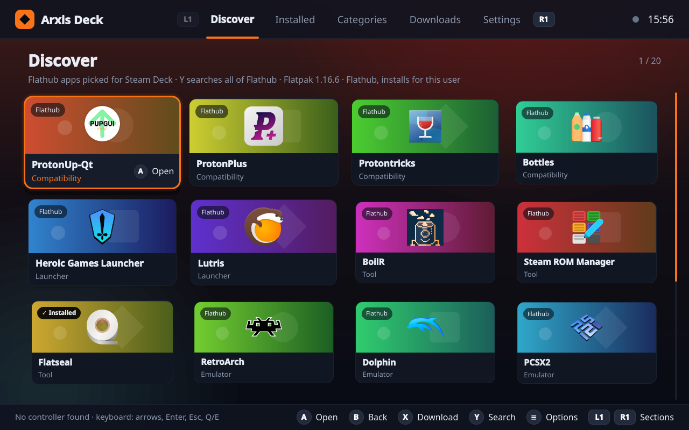
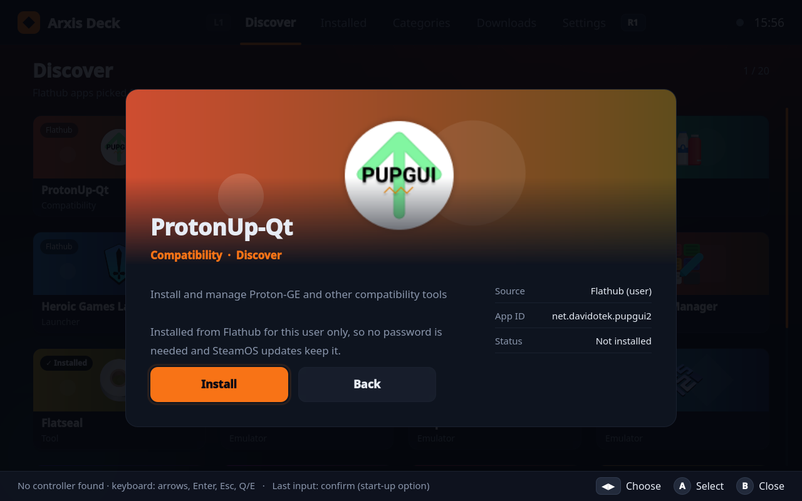
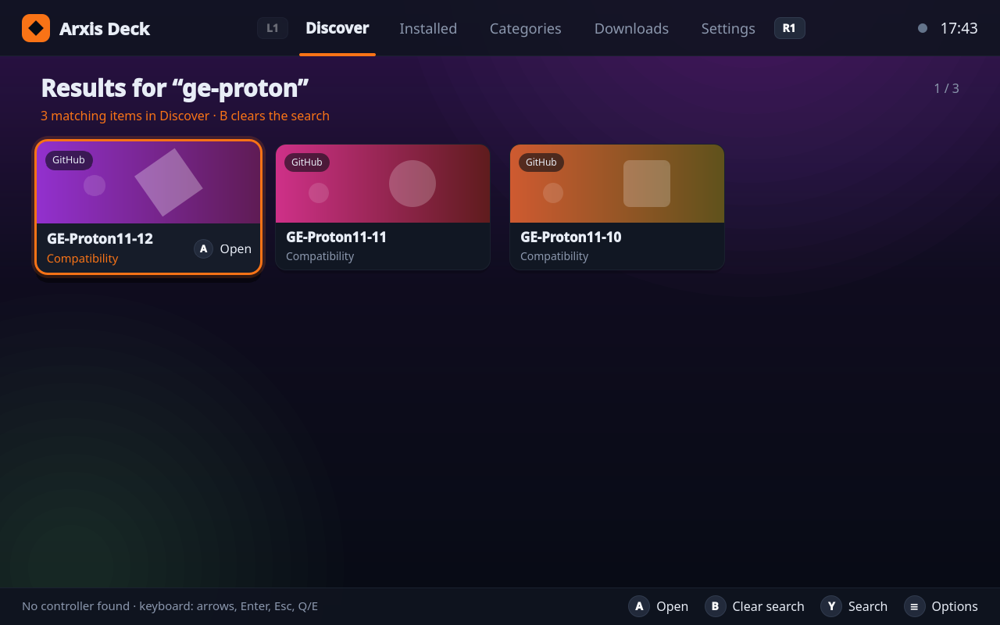
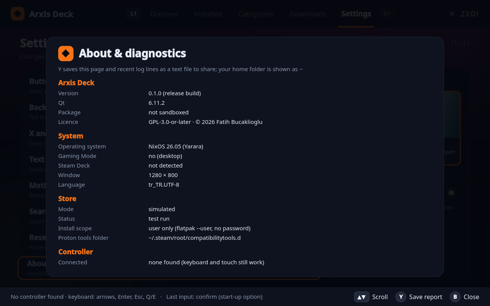

<p align="center">
  
</p>

<h1 align="center">Arxis Deck</h1>

<p align="center">
  A Steam Deck store for software and game tools, made for the controller.
</p>

<p align="center">
  <a href="https://github.com/APapinian/ArxisDeck/releases/latest"></a>
  <a href="LICENSE"></a>
  
</p>



Arxis Deck runs full screen at 1280×800 in Gaming Mode and is driven entirely by the
controller. It installs compatibility tools, launchers, emulators and utilities without
leaving Gaming Mode and without touching the read-only SteamOS system.

> **Status:** early test build (0.2.x). It works on a Linux desktop; the first test on a
> real Steam Deck is still to come (see [docs/DECK_TEST.md](docs/DECK_TEST.md)).

## Features

- **Flathub, user-wide:** apps are installed with `flatpak --user`, so no password is needed
  and SteamOS updates keep them.
- **Picked for Steam Deck:** ProtonUp-Qt, ProtonPlus, Protontricks, Bottles, Heroic, Lutris,
  BoilR, Steam ROM Manager, RetroArch, Dolphin, PCSX2 and more, plus a search across all of
  Flathub.
- **Know before you install:** version, download and installed size, licence and permissions
  are shown before anything is installed; uninstalling asks first.
- **Proton-GE from GitHub:** downloaded over HTTPS into Steam's `compatibilitytools.d`, with a
  SHA-512 check against the release. Existing folders are never overwritten.
- **Controller first:** D-pad, stick, A/B/X/Y, bumpers and triggers, with button hints on
  every screen. Keyboard, mouse and touch work too.
- **Comfort options:** larger text, reduced motion, Steam's on-screen keyboard for search.
- **Activity history and diagnostics:** every install and removal is logged; About &
  diagnostics saves a redacted report to share.

| App details | Proton-GE from GitHub | About & diagnostics |
|---|---|---|
|  |  |  |

## Install on a Steam Deck

Arxis Deck is not on Flathub yet. Until it is, install the bundle from the
[releases page](https://github.com/APapinian/ArxisDeck/releases/latest):

1. Switch to **Desktop Mode** and download `arxis-deck.flatpak` into **Downloads**.
2. Open **Konsole** and run:

   ```sh
   flatpak install --user ~/Downloads/arxis-deck.flatpak
   ```

   Answer **y** when it offers to add Flathub and the KDE runtime.
3. In **Steam → Games → Add a Non-Steam Game to My Library…**, tick **Arxis Deck**.
4. Back in **Gaming Mode**, start it from **Library → Non-Steam**.

Full guide, including updating and moving from 0.2.0: [packaging/README.md](packaging/README.md).

## Permissions

| Permission | Why |
|---|---|
| `--talk-name=org.freedesktop.Flatpak` | Install, remove, search and launch apps with the host's Flatpak, always as `--user` |
| `--device=all` | Read the controller from `/dev/input` and use the GPU |
| Flatpak appstream folders, read-only | Show real app icons |
| Wayland / X11 | Draw the window (Gaming Mode uses X11 through gamescope) |

Arxis Deck itself has no network permission; Flatpak does the downloads.

## Build from source

Rust (stable) and Qt 6 with QML. The crates are vendored in `vendor/`, so builds run offline.

```sh
# Flatpak bundle (downloads the KDE 6.11 SDK and Rust extension on first run)
sh packaging/build-flatpak.sh

# Or a native build, with Qt 6 installed
cargo build --release
./target/release/arxis-deck

# Formatting, clippy, tests and the controller self-test
sh scripts/check.sh
```

## Documentation

- [PROJECT.md](PROJECT.md): goals, scope and safety rules
- [ARCHITECTURE.md](ARCHITECTURE.md): how the app is put together
- [ROADMAP.md](ROADMAP.md) and [docs/STATUS.md](docs/STATUS.md): milestones and where things stand
- [docs/architecture-decisions/](docs/architecture-decisions/): technology stack and licence

## Licence

GPL-3.0-or-later, © 2026 Fatih Bucaklioglu. Licences of the bundled Rust crates are in
[THIRD-PARTY-LICENSES.md](THIRD-PARTY-LICENSES.md).

Arxis Deck is inspired by the [Arxis](https://github.com/APapinian/Arxis) project's feature set but is a
separate application. It is not affiliated with Valve; Steam and Steam Deck are trademarks of
Valve Corporation.
